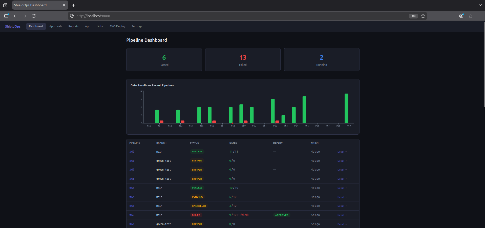
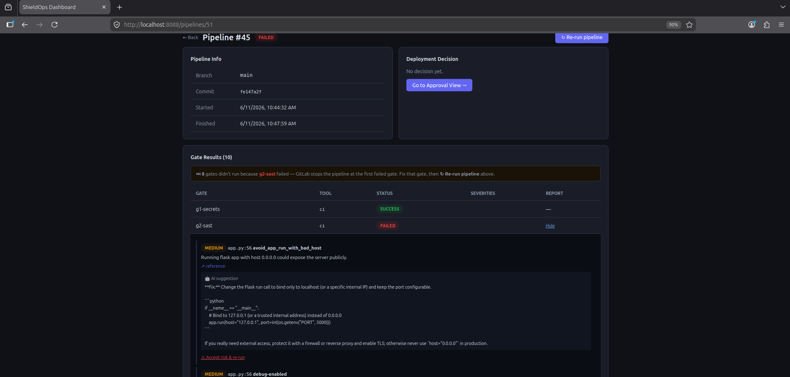
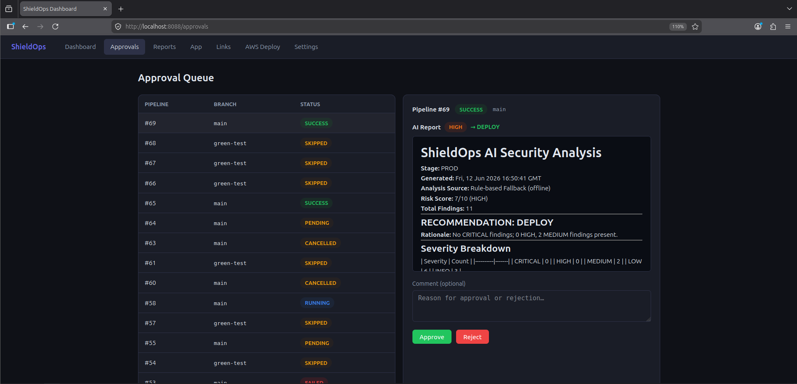
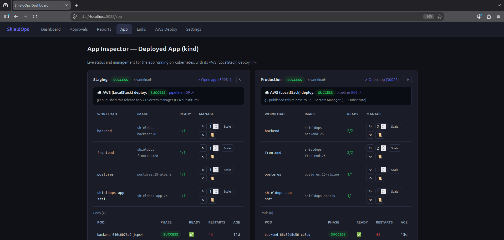
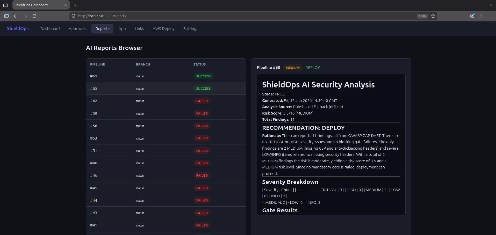
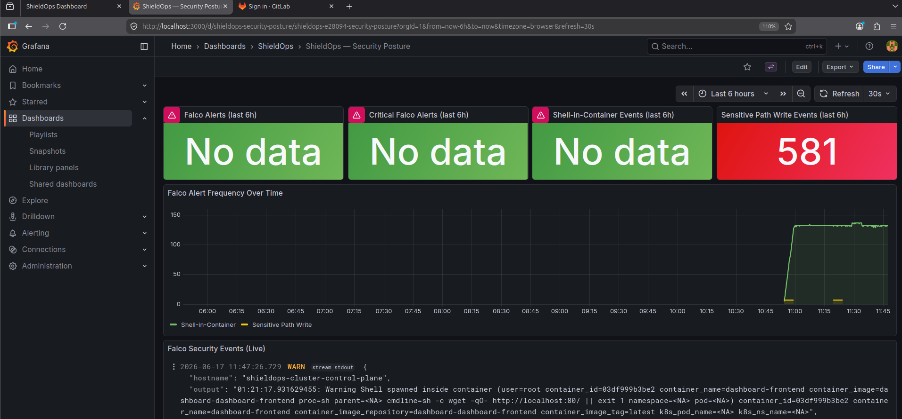
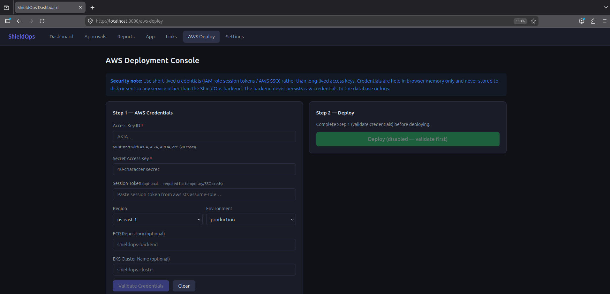

# ShieldOps

**AI-augmented DevSecOps pipeline for a 3-tier app, running on local Kubernetes (kind) + LocalStack.**

ShieldOps shows how to weave automated security gates, AI-assisted risk decisions, human approval and runtime observability into one CI/CD flow, entirely on a single Linux machine and without cloud spend. It was built as a final-year (PFE) DevSecOps project.



---

## What it does

A deliberately vulnerable 3-tier web app (Node/Express API + vanilla HTML/JS frontend on nginx + PostgreSQL) ships through a **GitLab CI/CD pipeline of security gates**. Every push is checked for secrets, SAST issues, vulnerable dependencies and images, IaC misconfigurations and Kubernetes policy violations.

When the static gates pass, an **AI analysis service** aggregates every scanner report into a structured risk recommendation (`DEPLOY` or `BACK_TO_DEV`). A human reviews it on the **ShieldOps dashboard** and approves the deployment. Helm deploys to staging, **OWASP ZAP** scans the live app, a second AI review gates production, and a final optional step "deploys to AWS" against **LocalStack**. **Falco**, Prometheus, Grafana and Loki watch the running workloads.

What makes it more than a tool integration:

| Differentiator | Where |
|---|---|
| Custom Semgrep rule for SQL injection through `node-postgres` string concatenation | `policy/semgrep/custom-rules.yaml` |
| 5 OPA/Rego policies for Kubernetes manifests (registry, labels, resources, security context, namespace), with unit tests | `policy/opa/` |
| AI analysis with provider fallback: **OpenRouter → Google Gemini → deterministic rule-based engine**, so the pipeline never hard-blocks on an AI outage | `ai-service/src/` |
| Dashboard that explains failures: per-gate findings (file, line, rule), AI fix suggestions, accept-risk & re-run | `dashboard/` |
| Two-repo model: developers own only their app; the platform team owns the pipeline | `ci/app-pipeline.yml`, `scripts/setup-app-repo.sh` |

---

## Architecture

```
┌──────────────────────────────────────────────────────────────────────────┐
│  Linux host (Docker)                                                     │
│                                                                          │
│  ┌──────────────────┐  ┌──────────────────────┐  ┌────────────────────┐  │
│  │ GitLab CE :8929  │  │ ShieldOps dashboard  │  │ LocalStack :4566   │  │
│  │ GitLab Runner    │  │  React (nginx) :8088 │  │ S3, Secrets Mgr,   │  │
│  │ (docker executor)│  │  Express API   :4000 │  │ STS, DynamoDB      │  │
│  └───────┬──────────┘  │  Postgres      :5434 │  └────────────────────┘  │
│          │ webhooks ──►└──────────────────────┘  Registry (registry:2)   │
│          │ helm deploys                          localhost:5000          │
│  ┌───────▼────────────────────────────────────────────────────────────┐  │
│  │  kind cluster: shieldops-cluster                                   │  │
│  │   development │ staging (NodePort 30081) │ production (30082)      │  │
│  │     backend, frontend, postgres in each app namespace              │  │
│  │   monitoring: Prometheus, Grafana, Loki + Promtail, Falco          │  │
│  └────────────────────────────────────────────────────────────────────┘  │
└──────────────────────────────────────────────────────────────────────────┘
```

All containers share the Docker network `docker_shieldops-net`, so CI jobs reach `gitlab`, `registry`, `localstack`, `dashboard-backend` and the kind control plane by name. The full Mermaid diagrams are in [`docs/architecture.md`](docs/architecture.md); see also [`docs/architecture.svg`](docs/architecture.svg) and [`docs/workflow-diagram.png`](docs/workflow-diagram.png).

### Two repositories, two perspectives

| Repository | Owner | Contains |
|---|---|---|
| `shieldops` (this repo) | DevSecOps / platform | Pipelines, policies, Terraform, Helm chart, AI service, dashboard, observability |
| `shieldops-app` | Developer | Only the app source, plus a short `.gitlab-ci.yml` that `include:`s [`ci/app-pipeline.yml`](ci/app-pipeline.yml) from this repo |

`scripts/setup-app-repo.sh` creates the app project in GitLab, copies the CI/CD variables, allowlists the job token and registers the dashboard webhook. The developer cannot weaken the gates because the pipeline lives in the platform repo.

---

## Security gates

| Gate | Tool | What blocks | Notes |
|------|------|-------------|-------|
| **G1** Secrets | Gitleaks v8.18.2 (`.gitleaks.toml`) | Any committed secret | |
| **G2** SAST | Semgrep 1.58.0 (OWASP Top 10, Node.js, custom rule) | ERROR-level findings | |
| **G3** SCA + image | Trivy 0.50.1 (filesystem + built image) | CRITICAL CVEs | HIGH/MEDIUM are reported, not blocking |
| **G4** IaC | Checkov 3.2.33 + tfsec v1.28.6 | Targeted checks | Platform repo only; runs when `terraform/` changes, on MRs/schedules, or manually |
| **G5** K8s policy | Conftest v0.57.0 + `policy/opa/` | Nothing (soft-fail) | Platform repo only; violations are logged and fed to the AI |
| **G6** AI staging | AI service | Human decision | Report posted to the dashboard → **manual** Helm deploy to `staging` |
| **G7** DAST | OWASP ZAP | Baseline scan failures | Baseline on push, full scan on schedule |
| **G8** AI production | AI service (all G1–G7 reports) | Human decision | **Manual** Helm deploy to `production` |
| **G9** LocalStack deploy | AWS CLI → LocalStack | — | App pipeline only, **manual**: STS identity, release artifact to S3, secret to Secrets Manager, record in DynamoDB |

Every gate uploads its report to S3 (`ci/upload-report.sh`), so the evidence of each run is kept. The AI analysis is described in [`docs/ai-analysis.md`](docs/ai-analysis.md); the mapping from gates to OWASP and the threat model is in [`SECURITY.md`](SECURITY.md).

---

## Dashboard

React + Express + PostgreSQL, fed by GitLab webhooks and by the reports CI posts to it (`ci/post-report.sh`).

- **Dashboard** – pass/fail stats and gate results for recent pipelines
- **Pipeline detail** – every gate with a "What failed?" view (file, line, rule, message), an **AI fix suggestion** per finding, *accept risk & re-run*, and *re-run pipeline*
- **Approvals** – read the AI report, then approve or reject. Approving resumes the manual GitLab deploy job.
- **Reports** – browse every AI report
- **App** – live view of the staging and production workloads on kind (restart, scale, roll back, logs) and their LocalStack deploy status
- **AWS Deploy** – a console for a real AWS deploy (`ci/deploy-aws.sh`). Credentials are validated with a preflight checklist and never stored.
- **Links** – deep links to Grafana, Prometheus, Loki, ZAP and GitLab

| Pipeline detail with AI fix | Approval queue | App inspector |
|---|---|---|
|  |  |  |

| AI reports | Grafana security posture (Falco) | AWS deploy console |
|---|---|---|
|  |  |  |

---

## Getting started

### Prerequisites

- Linux host with Docker (Compose plugin). Plan for about 16 GB RAM and 40 GB of free disk: the GitLab and ZAP images are large.
- `kind` v0.23+, `kubectl`, `helm` v3, `terraform`, Node.js 20
- An AI API key, recommended (see below)

### API keys

The AI features need a key from an LLM provider. Both providers below have a free tier.

| Key | Get it at | Used by | Without it |
|---|---|---|---|
| `OPENROUTER_API_KEY` (recommended) | https://openrouter.ai/keys | AI analysis in G6/G8, and the dashboard's **"Suggest fix (AI)"** button | Pipeline: rule-based fallback report. Dashboard: AI fix suggestions are disabled. |
| `GEMINI_API_KEY` (alternative) | https://aistudio.google.com/app/apikey | AI analysis in G6/G8 only | Rule-based fallback report |

Where each key goes:

- **Pipeline:** a masked GitLab CI/CD variable (step 7)
- **Dashboard:** `dashboard/.env` (step 5)
- **Running the AI service locally:** `ai-service/.env` (copy `ai-service/.env.example`)

The `.env` files are git-ignored. Never commit a real key; if one leaks, revoke it at the provider and create a new one.

### 1. Platform services

```bash
git clone https://github.com/<you>/shieldops.git && cd shieldops

# GitLab CE, LocalStack, registry:2, Postgres on the docker_shieldops-net network
docker compose -f docker/docker-compose.yml up -d
```

GitLab takes a few minutes to boot and is served at http://localhost:8929. The initial `root` password is in `docker exec gitlab cat /etc/gitlab/initial_root_password`.

### 2. GitLab Runner

The runner is not part of the compose file. Start it and register a **docker executor** whose jobs join the platform network:

```bash
docker run -d --name gitlab-runner --restart always --network docker_shieldops-net \
  -v /var/run/docker.sock:/var/run/docker.sock \
  -v "$PWD/docker/gitlab-runner/config:/etc/gitlab-runner" \
  gitlab/gitlab-runner:latest

docker exec gitlab-runner gitlab-runner register --non-interactive \
  --url http://gitlab:8929 --clone-url http://gitlab:8929 --token <runner-token> \
  --executor docker --docker-image docker:24.0.5 --docker-privileged \
  --docker-network-mode docker_shieldops-net \
  --docker-volumes /var/run/docker.sock:/var/run/docker.sock
```

Create the runner in GitLab (*Admin → CI/CD → Runners*) with *Run untagged jobs* enabled, because the pipeline's jobs have no tags.

### 3. Kubernetes cluster

```bash
kind create cluster --name shieldops-cluster --config kubernetes/kind-config.yaml
kind get kubeconfig --name shieldops-cluster > /tmp/kc && export KUBECONFIG=/tmp/kc
for ns in development staging production; do kubectl create namespace $ns; done
docker network connect docker_shieldops-net shieldops-cluster-control-plane
```

The kind node must also trust the plain-HTTP registry `registry:5000`; step 4 of `scripts/startup.sh` applies that containerd configuration.

### 4. LocalStack resources

```bash
cd terraform && terraform init && terraform apply -auto-approve && cd ..
```

This creates the S3 report and asset buckets and the Secrets Manager secret. LocalStack Community does not persist data, so re-run it after every LocalStack restart (`scripts/startup.sh` does).

### 5. Dashboard

```bash
cd dashboard
cp .env.example .env      # set passwords, JWT secret, GITLAB_TOKEN, OPENROUTER_API_KEY, ...
docker compose up -d
docker network connect docker_shieldops-net dashboard-backend
cd ..
```

Dashboard: http://localhost:8088

### 6. Observability

```bash
cd observability && ./install.sh && cd ..
```

Grafana and Prometheus are exposed as NodePorts on the kind node (`<node-ip>:32000` and `<node-ip>:30090`). See [`observability/README.md`](observability/README.md).

### 7. GitLab projects and CI/CD variables

Push this repo to a GitLab project `root/shieldops` and set these CI/CD variables:

| Variable | Type | Value |
|---|---|---|
| `KUBECONFIG` | File | output of `kind get kubeconfig --internal --name shieldops-cluster` |
| `OPENROUTER_API_KEY` / `GEMINI_API_KEY` | Masked | optional AI provider keys |
| `DASHBOARD_INGEST_TOKEN` | Masked | same value as `GITLAB_WEBHOOK_TOKEN` in `dashboard/.env` |

Add a project webhook for pipeline events pointing at `http://dashboard-backend:4000/api/webhooks/gitlab`, with that token as its secret. Then create the developer repo and run its pipeline:

```bash
bash scripts/setup-app-repo.sh
bash scripts/run-app-pipeline.sh --watch
```

> The app pipeline fetches the platform repo at `PLATFORM_REF` (default `green-test`, set in `ci/app-pipeline.yml` and `scripts/setup-app-repo.sh`). Either push this repo to a `green-test` branch as well, or change `PLATFORM_REF` to `main`.

After a reboot, `bash scripts/startup.sh` brings everything back ([`docs/STARTUP.md`](docs/STARTUP.md)).

---

## Running the tests

```bash
(cd ai-service && npm ci && npm test)               # report parsers + fallback engine
(cd dashboard/backend && npm ci && npm test)        # webhooks, pipelines, redaction, AWS preflight
conftest verify -p policy/opa                       # Rego policy unit tests
semgrep --test policy/semgrep/                      # custom rule: true-positive / true-negative cases
```

---

## Repository layout

```
.gitlab-ci.yml          Platform pipeline (G1–G8, incl. IaC + OPA gates)
ci/
  app-pipeline.yml      Central pipeline included by the developer app repo (G1–G3, G6–G9)
  *.sh                  Image build/push, report upload/post, LocalStack + AWS deploy
app/                    Vulnerable-by-design 3-tier app
  backend/ frontend/ database/
  helm/shieldops-app/   Helm chart (dev / staging / prod / secure / aws-prod values)
  VULNERABILITIES.md    Map of the intentional vulnerabilities (V1–V8) and their gates
ai-service/             Report parsers + OpenRouter / Gemini / rule-based analysis
dashboard/              React frontend + Express backend + migrations
policy/                 Semgrep custom rule, OPA/Rego policies, Trivy and IaC policy notes
terraform/              LocalStack IaC (S3 buckets, Secrets Manager)
  aws/                  Real-AWS IaC: ECS Fargate, ECR, RDS, ALB, KMS (validated, not applied)
observability/          Helm values for Prometheus, Grafana, Loki/Promtail, Falco + rules
kubernetes/             kind cluster config
docker/                 Platform docker-compose (GitLab, LocalStack, registry, Postgres)
scripts/                Startup, demo reset, app-repo setup, pipeline trigger
docs/                   Architecture, demo scripts, AI analysis, AWS deploy, per-tool docs
screenshots/ logos/     Images used in the docs
```

---

## Documentation

- [`docs/architecture.md`](docs/architecture.md): architecture and pipeline diagrams
- [`docs/TEST-A-REAL-CASE.md`](docs/TEST-A-REAL-CASE.md): walk-through from vulnerable code through the pipeline to a fix and deploy
- [`docs/DEMO.md`](docs/DEMO.md): end-to-end demo script
- [`docs/ai-analysis.md`](docs/ai-analysis.md): prompt design, output schema, fallback scoring
- [`docs/aws-deploy.md`](docs/aws-deploy.md): real-AWS deployment path
- [`docs/tools/`](docs/tools/): why each tool was chosen and how it is configured
- [`docs/STARTUP.md`](docs/STARTUP.md): restoring the platform after a reboot
- [`SECURITY.md`](SECURITY.md): threat model and mapping from gates to OWASP

---

## Limitations

- **LocalStack Community** has no ECR/ECS/EKS/ALB, so the "AWS deploy" (G9) runs the app on kind and uses S3 as a stand-in for ECR. The real-AWS Terraform in `terraform/aws/` passes `terraform validate` but has never been applied.
- Free-tier AI models are rate-limited; when every provider fails, the rule-based fallback produces the report.
- Credentials in the compose files, Helm values and `.env.example` files are **local demo defaults**. Change them before exposing anything.
- The app in `app/` is **intentionally insecure** in its default configuration. Never deploy it publicly.

---

## License

[MIT](LICENSE)
