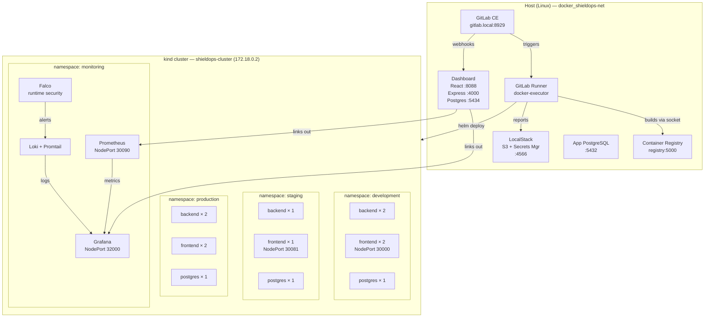
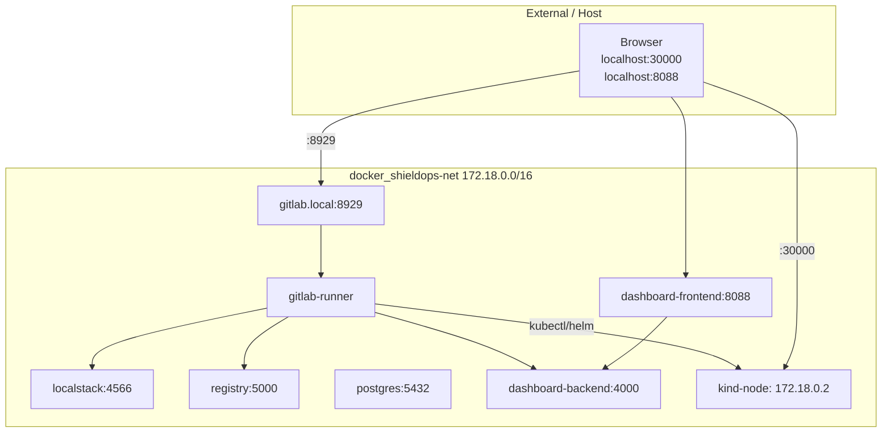

# ShieldOps — Architecture

## System components

---

## CI/CD pipeline flow

```mermaid
flowchart LR
    PUSH[git push] --> G1

    subgraph SECRETS[Stage: secrets]
        G1[G1 Gitleaks<br/>detect committed secrets]
    end

    subgraph SAST[Stage: sast]
        G2[G2 Semgrep<br/>OWASP + custom SQLi rule]
    end

    subgraph SCA[Stage: sca-image]
        G3B[G3a build-image<br/>docker build + push]
        G3F[G3b trivy-fs<br/>SCA filesystem]
        G3I[G3c trivy-image<br/>Docker image CVEs]
    end

    subgraph IAC[Stage: iac]
        G4C[G4a Checkov<br/>Terraform IaC]
        G4T[G4b tfsec<br/>Terraform IaC]
    end

    subgraph POLICY[Stage: policy]
        G5[G5 OPA/Conftest<br/>Helm manifest governance<br/>SOFT-FAIL]
    end

    subgraph AI_STG[Stage: ai-staging]
        G6A[G6a AI analysis<br/>Gemini / fallback<br/>→ ai-report-staging.json]
        G6D[G6b deploy-staging<br/>MANUAL GATE<br/>Helm → staging]
    end

    subgraph DAST[Stage: dast]
        G7[G7 OWASP ZAP<br/>baseline or full scan<br/>target: staging:30081]
    end

    subgraph AI_PROD[Stage: ai-prod]
        G8A[G8a AI analysis<br/>all G1-G7 reports<br/>→ ai-report-prod.json]
        G8D[G8b deploy-production<br/>MANUAL GATE<br/>Helm → production]
    end

    G1 -->|pass| G2
    G1 -->|fail - secret found| BLOCK1[BLOCKED]
    G2 -->|pass| G3B
    G2 -->|fail - SQLi/SAST| BLOCK2[BLOCKED]
    G3B --> G3F & G3I
    G3F & G3I -->|pass| G4C & G4T
    G4C & G4T --> G5
    G5 -->|always pass - soft-fail| G6A
    G6A --> G6D
    G6D -->|human approves| G7
    G7 --> G8A
    G8A --> G8D
    G8D -->|human approves| DEPLOYED[Production live]

    style BLOCK1 fill:#c00,color:#fff
    style BLOCK2 fill:#c00,color:#fff
    style G5 fill:#f90,color:#000
    style G6D fill:#06c,color:#fff
    style G8D fill:#06c,color:#fff
    style DEPLOYED fill:#090,color:#fff
```

---

## Network topology

---

## Namespace layout

| Namespace | Workloads | Notes |
|-----------|-----------|-------|
| `development` | backend × 2, frontend × 2 (NodePort 30000), postgres | Always-on dev environment |
| `staging` | backend × 1, frontend × 1 (NodePort 30081), postgres | Deployed by G6 manual gate; ZAP target |
| `production` | backend × 2, frontend × 2, postgres | Deployed by G8 manual gate |
| `monitoring` | Prometheus, Grafana, Loki, Promtail, Falco | Observability stack; persistent |

---

## Key file paths

| Concern | Path |
|---------|------|
| Pipeline definition | `.gitlab-ci.yml` |
| Helm chart | `app/helm/shieldops-app/` |
| Custom Semgrep rule | `policy/semgrep/custom-rules.yaml` |
| OPA Rego policies | `policy/opa/*.rego` |
| AI service entrypoint | `ai-service/src/index.js` |
| Gemini client | `ai-service/src/gemini.js` |
| Rule-based fallback | `ai-service/src/fallback.js` |
| Dashboard backend | `dashboard/backend/src/` |
| Falco custom rules | `observability/falco/rules.yaml` |
| Grafana dashboards | `observability/grafana/dashboards/` |
| Terraform (LocalStack) | `terraform/main.tf` |
| kind cluster config | `kubernetes/kind-config.yaml` |
| Vulnerability map | `app/VULNERABILITIES.md` |
